# FarStudio brand package

<p align="center">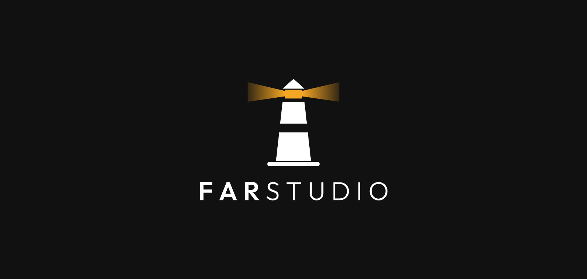</p>

FarStudio's logo, icons, banners and typeface, and which file to use where. FarStudio is the indie studio behind our games and apps (Steam, App Store, Google Play, YouTube). This is the studio's brand, not any game's: games keep their own identity and the studio signs them.

- **[USO.md](USO.md)**: this same guide in Spanish.
- **[integrations/](integrations/)**: step-by-step tasks to apply the brand in each project. Start with [integrations/CrimeSudoku.md](integrations/CrimeSudoku.md).
- **[tools/](tools/)**: the scripts that build every file, to regenerate them after a change (see the end of this file).

## Contents

```
svg/        Vector masters. The lettering is already converted to outlines: no font needed.
  animated/         The lighthouse with its light animated (rotate, blink or ignite), SVG.
png/        The same files as PNG, from 3840 px down.
  symbol/           The lighthouse alone.
  logo-vertical/    Lighthouse above the name. The primary version.
  logo-horizontal/  Lighthouse | name, with a divider line. The secondary version.
  wordmark/         The name alone.
  app-icon/         Store icon: square (full bleed, no transparency) and rounded (rounded corners, transparent outside).
  avatar/           Profile picture: square (the platform crops it) and circle (already cropped).
  favicon/          Web icons: favicon.ico, 16, 32, 48, 192, 512 and a 180 apple-touch-icon.
  banners/          Headers and screens already composed on a background.
fonts/      Outfit, variable font (OFL license, may be bundled with a game).
integrations/  How to apply the brand in each project.
tools/      The scripts that build svg/, png/ and the pictures of this README.
docs/readme/   The pictures of this README.
```

Every PNG has its size in its name: `farstudio-logo-horizontal-color-on-dark-1024x283.png` is 1024 × 283 px. The number in each list is the longest side.

## Color variants

<table>
<tr><td>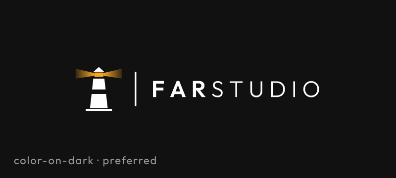</td><td>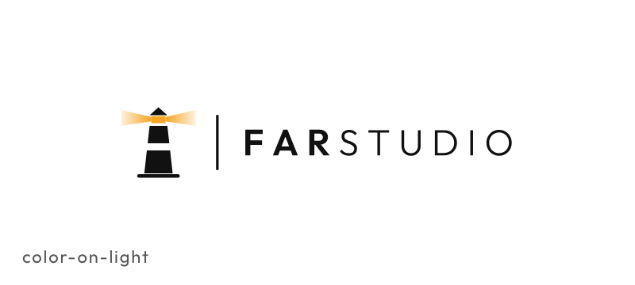</td></tr>
<tr><td>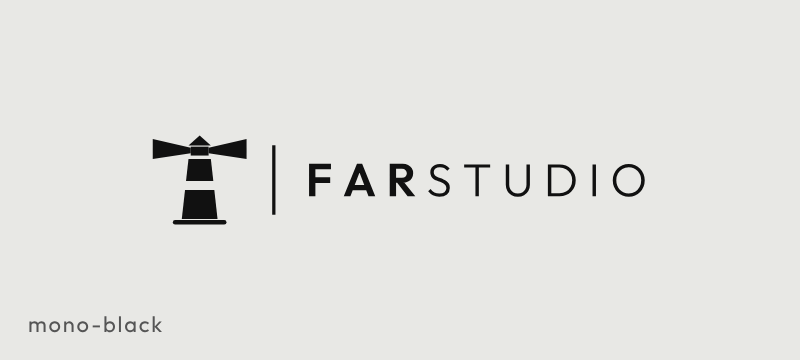</td><td>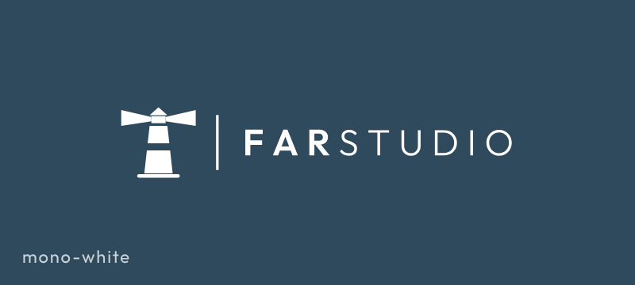</td></tr>
</table>

| Variant | When |
|---|---|
| `color-on-light` | White or light backgrounds. Lighthouse and name in black, light in amber. |
| `color-on-dark` | Black or dark backgrounds. Lighthouse and name in white, light in amber. **The preferred version**: the light shows best on black. |
| `mono-black` | All black, no amber. One-color print, stamps, engraving, black and white documents. |
| `mono-white` | All white, no amber. Over photos or colored backgrounds where the amber would not read. |

All have a transparent background except `app-icon`, `avatar` and `banners`, which carry their black background.

## Which piece

<table>
<tr><td>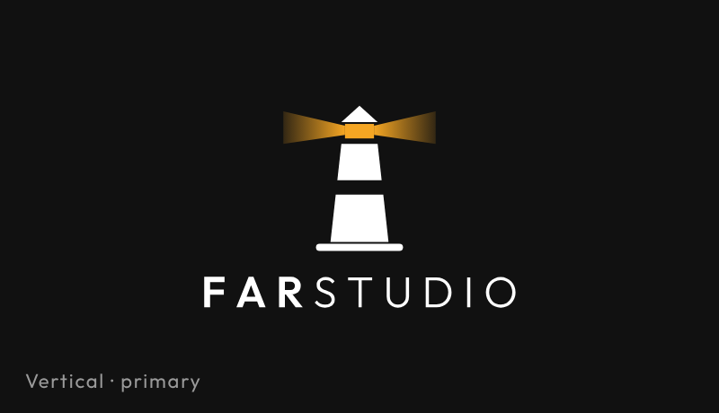</td><td>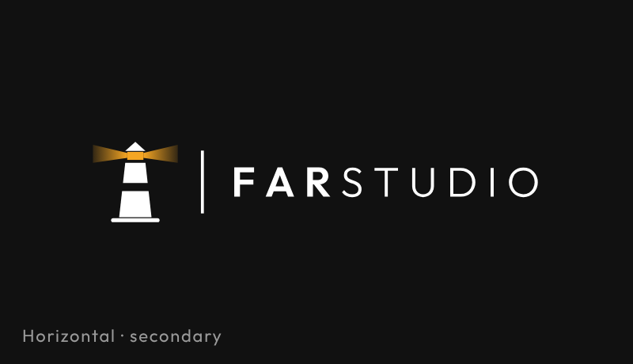</td></tr>
<tr><td>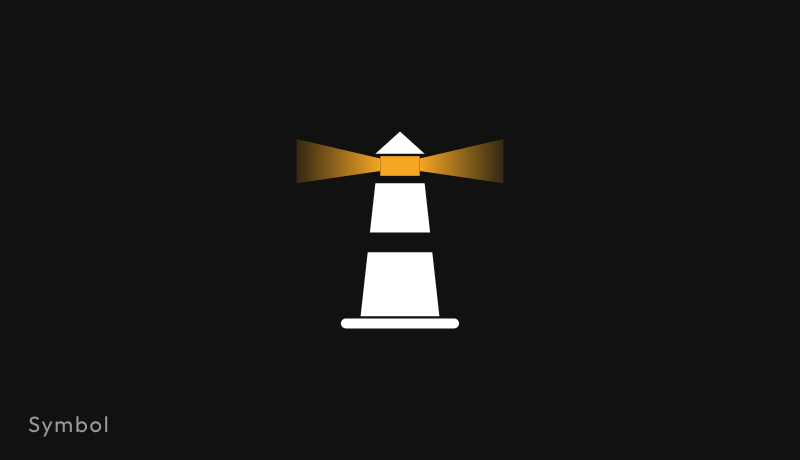</td><td>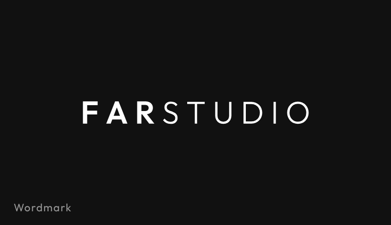</td></tr>
</table>

- **Vertical**: the primary logo. Credits, splash, posters, covers, press kit.
- **Horizontal** (lighthouse | name): when there is little height. Web and channel headers, footers, signatures, a watermark on trailers.
- **Symbol**: anything square or very small. Icons, avatars, favicon, anything under 32 px.
- **Wordmark**: the name alone, only when the lighthouse is already shown nearby (next to the avatar on a store page, for example).

## Which file for each place

<p>
&nbsp;
&nbsp;
&nbsp;
&nbsp;

</p>
<p>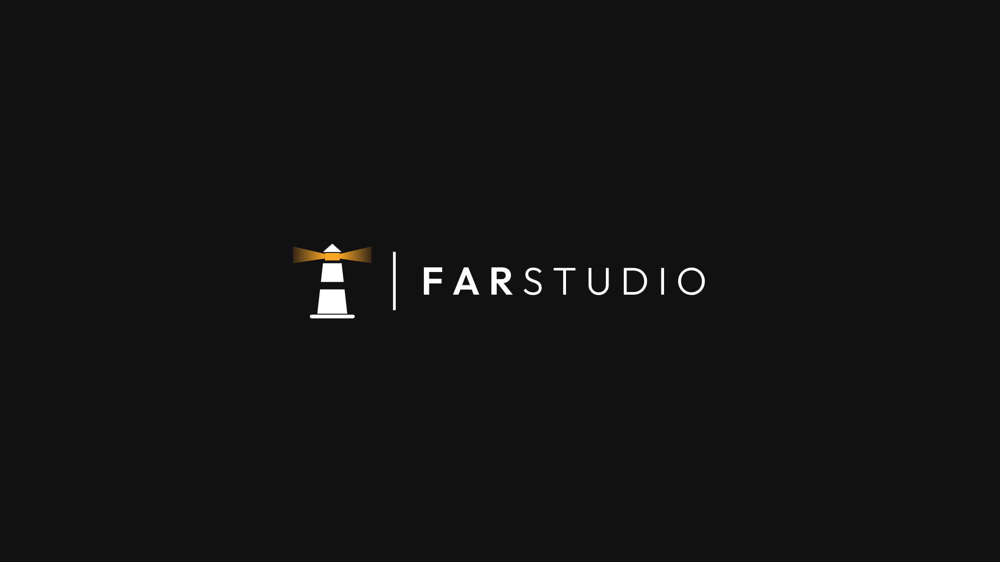 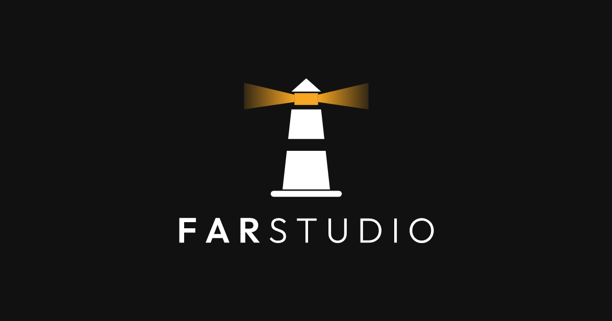</p>

The app icon, the avatar and the favicons at their real sizes, and two of the banners. All of them are ready to upload as they are.

| Where | File |
|---|---|
| **App Store**, developer icon | `app-icon/square/…-1024x1024.png` (Apple refuses transparency and rounds it itself) |
| **Google Play**, icon | `app-icon/square/…-512x512.png` |
| **Google Play**, feature graphic | `banners/store-feature-graphic-1024x500.png` |
| **Steam**, developer avatar | `avatar/square/…-256x256.png` or `…-512x512.png` |
| **Steam**, developer page header | `logo-horizontal/color-on-dark/…-1920x531.png` on black, or `banners/social-header-1500x500.png` |
| **YouTube**, channel picture | `avatar/square/…-800x800.png` |
| **YouTube**, channel banner | `banners/youtube-banner-2560x1440.png` (the logo sits inside the safe area) |
| **Social networks**, profile picture | `avatar/square/…-400x400.png` or `…-800x800.png` |
| **Social networks**, header | `banners/social-header-1500x500.png` |
| **Gmail / Google**, account picture | `avatar/square/…-800x800.png` |
| **Web**, header | `svg/farstudio-logo-horizontal-color-on-light.svg` (or `-on-dark` on a dark header) |
| **Web**, footer | `svg/farstudio-logo-horizontal-color-on-dark.svg` or `mono-white` |
| **Web**, favicon | `favicon/favicon.ico` + `favicon-32x32.png` + `favicon-16x16.png` + `apple-touch-icon-180x180.png` |
| **Web**, installable app icon | `favicon/favicon-192x192.png` and `favicon-512x512.png` |
| **Web**, link preview | `banners/link-preview-1200x630.png` |
| **Game**, launch splash | `banners/splash-dark-1920x1080.png` (or `-3840x2160`); in portrait, `logo-vertical/color-on-dark` centered on black |
| **Game**, credits | `logo-vertical/color-on-dark/…-1024x….png` |
| **Game / trailer**, corner signature | `logo-horizontal/color-on-dark/…-512x….png` |
| **Press kit, slides** | Vertical or horizontal as SVG; 2560 or 3840 PNG where vectors are not accepted |
| **Print** (cards, stickers, shirts) | Always SVG. For one color, `mono-black` or `mono-white` |
| **Email signature** | `symbol/color-on-light/…-64x….png` (sharp on high-density screens) |

When a place asks for a size that is not here, take the next larger one and let the platform scale it down, or export from the SVG.

## Animated logo

`svg/animated/` has the lighthouse with its light moving, for the web, splash screens and intros. Pure SVG + CSS: it plays inside an `` tag, with no JavaScript, and it stays still for people who ask their system for reduced motion.

| Animation | What it does | Loop |
|---|---|---|
| `rotate` | The beam sweeps around: right, towards you (the lantern flashes), left, then behind (the light dims). | 6 s |
| `blink` | The light stays on and gives two short flashes off, like a lighthouse signal. | 3.2 s |
| `ignite` | The lighthouse switching on: a quick flicker that builds up in strength, a second in the dark, then the light slowly comes on fully and stays lit. For intros and splash screens. | once, 4 s |

Each comes as `symbol`, `logo-vertical` and `logo-horizontal`, in `color-on-dark` (preferred) and `color-on-light`, for example `svg/animated/farstudio-symbol-color-on-dark-rotate.svg`. Only the light moves; the lighthouse and the name stay as they are. To rebuild `ignite` in a game engine or another tool, [`animation/ignite/`](animation/ignite/README.md) has the logo split into layers, the timeline as JSON and the steps. Use one animated logo per screen, and the static one wherever the logo is small or sits next to text.

## Rules

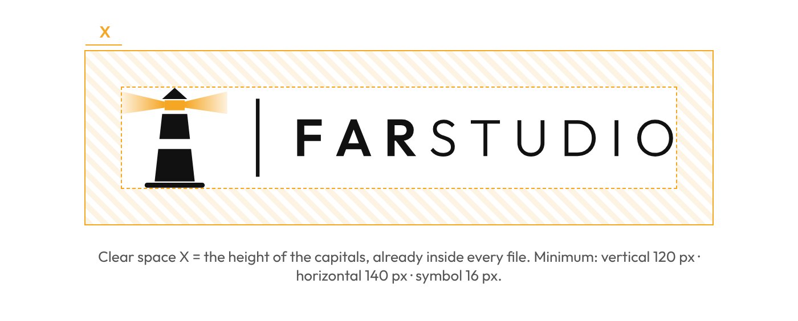

- **Clear space**: keep at least the height of the name's capitals (X) free around the logo. The SVG and PNG files already include it.
- **Minimum sizes**: vertical 120 px wide (30 mm), horizontal 140 px (35 mm), symbol 16 px (5 mm). Below that, use the symbol alone.
- **Never**: stretch, rotate, change the typeface, lighten or gray it, place it on a background without contrast, add shadows or effects, reorder the pieces or move them further apart.
- **Amber is only the lighthouse's light**: the lantern and the beams. Never on the name or on the rest of the lighthouse.

## Colors

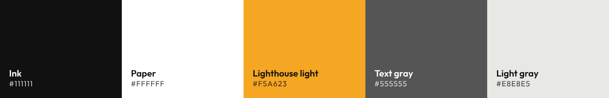

| Color | HEX | RGB | Use |
|---|---|---|---|
| Ink | `#111111` | 17 17 17 | Lighthouse, name, dark backgrounds |
| Paper | `#FFFFFF` | 255 255 255 | Backgrounds, the logo on dark |
| Lighthouse light | `#F5A623` | 245 166 35 | Only the lantern and the beams; the beams fade from 100 % to 15 % outwards |
| Text gray | `#555555` | 85 85 85 | Secondary text |
| Light gray | `#E8E8E5` | 232 232 229 | Supporting backgrounds and dividers |

## Typeface

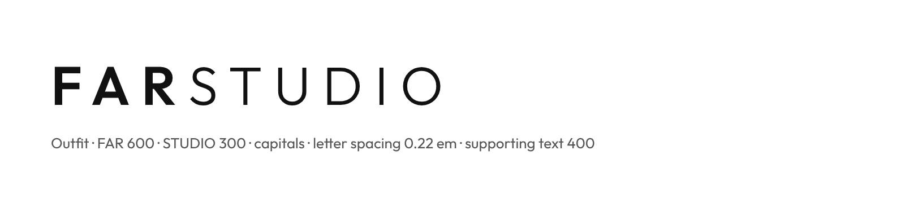

Outfit (Google Fonts, OFL). In the name: **FAR** at weight 600 and STUDIO at weight 300, all capitals, letter spacing 0.22 em. Outfit 400 for supporting text.

## Regenerating the files

The masters are built in code, so a change to the logo is made once and every size follows.

```
python3 tools/build_masters.py fonts/Outfit-Variable.ttf svg     # SVG masters, lettering as outlines (needs fontTools)
python3 tools/render.py svg png                                    # every PNG, favicon and banner (needs Playwright + Chromium)
python3 tools/animate.py svg svg/animated                           # animated SVGs, from the colour masters
python3 tools/ignite_kit.py svg/animated animation/ignite           # ignite kit: layers and timeline JSON (needs Playwright + Chromium)
```

`favicon.ico` (16, 32 and 48) is then packed from `png/favicon/` with Pillow. The pictures of this README are in `docs/readme/`, made by `python3 tools/readme_images.py`.
