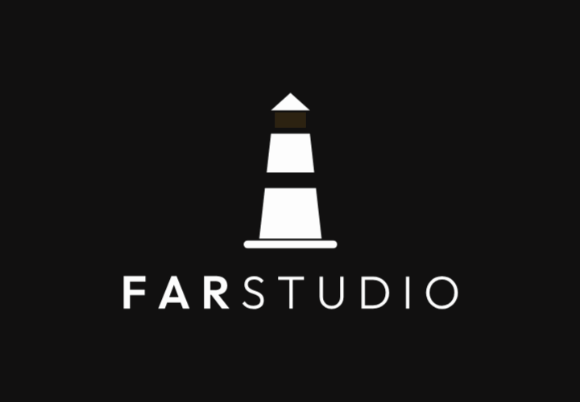

# Ignite: the lighthouse switching on

<p align="center"></p>

Everything needed to rebuild the FarStudio "ignite" animation in a game engine, an app or a video tool. The finished reference is the SVG in `svg/animated/` (for example `farstudio-logo-vertical-color-on-dark-ignite.svg`): open it in a browser to see what the result must look like.

It lasts **4 s** and plays **once**. The lamp gives five quick flashes, each brighter than the last, then stays dark for about a second, then comes on slowly while the beams grow out of the lantern. A soft glow blooms behind the lighthouse near the end and fades. The logo then stays lit, identical to the static logo.

Only the amber light moves. The lighthouse and the name never move, scale or change color.

## Files

```
animation/ignite/
  ignite-timeline.json     The whole animation as keyframes, plus the pivots of every piece. The source of truth.
  layers/<piece>/          symbol, logo-vertical, logo-horizontal
    base-color-on-dark.png   Lighthouse and name, without the light. For dark backgrounds.
    base-color-on-light.png  The same for light backgrounds.
    glow.png                 Soft amber halo.
    lamp.png                 The lantern.
    beam-left.png
    beam-right.png
```

Every layer is a transparent PNG the size of the whole logo (2048 px on the longest side), so the layers stack with no offsets: put them all at the same position and size. Use the `base` that matches the background; the light layers are the same on both.

**Order, bottom to top:** `glow`, `base`, `lamp`, `beam-left`, `beam-right`. The glow sits behind the tower.

## Pivots

The beams scale horizontally from the edge of the lantern, and the glow scales from the lantern's center. Pivots are fractions of the layer's width and height. Engines that count from the top (CSS, most 2D tools) use `y from top`; Unity sprites count from the bottom.

| Piece | Pivot | x | y from top | y from bottom (Unity) |
|---|---|---|---|---|
| symbol | beam-left | 0.4179 | 0.2003 | 0.7997 |
| symbol | beam-right | 0.5821 | 0.2003 | 0.7997 |
| symbol | glow | 0.5 | 0.2217 | 0.7783 |
| logo-vertical | beam-left | 0.4616 | 0.1989 | 0.8011 |
| logo-vertical | beam-right | 0.5384 | 0.1989 | 0.8011 |
| logo-vertical | glow | 0.5 | 0.2127 | 0.7873 |
| logo-horizontal | beam-left | 0.1263 | 0.298 | 0.702 |
| logo-horizontal | beam-right | 0.1582 | 0.298 | 0.702 |
| logo-horizontal | glow | 0.1422 | 0.3124 | 0.6876 |

In Unity, set each layer's sprite pivot to these values (Sprite Editor, Custom Pivot) and scale the transform; or keep the pivots centered and put each beam under an empty parent placed at the pivot.

## Timeline

Times in milliseconds. Opacity multiplies the layer's own alpha (the PNGs already carry the beams' fade). "Hold" means the value stays put and jumps at the next row: the flashes are hard cuts, not fades.

**Lamp** (opacity)

| From | Value | Then |
|---|---|---|
| 0 | 0.12 | hold |
| 100 | 0.30 | hold (flash 1) |
| 200 | 0.12 | hold |
| 310 | 0.45 | hold (flash 2) |
| 400 | 0.12 | hold |
| 540 | 0.60 | hold (flash 3) |
| 660 | 0.12 | hold |
| 760 | 0.80 | hold (flash 4) |
| 850 | 0.12 | hold |
| 990 | 1.00 | hold (flash 5) |
| 1090 | 0.12 | hold: dark for about a second |
| 2090 | 0.12 | ease `cubic-bezier(0.4, 0, 0.2, 1)` to the next row |
| 3350 | 1.00 | stays |

**Beams** (opacity and horizontal scale, both beams the same)

| From | Opacity | Scale X | Then |
|---|---|---|---|
| 0 | 0 | 1 | hold |
| each flash | half the lamp's value (0.15, 0.225, 0.3, 0.4, 0.5) | 1 | hold |
| each flash's end | 0 | 1 | hold |
| 2150 | 0 | 0.1 | ease `cubic-bezier(0.35, 0, 0.15, 1)` to the next row |
| 4000 | 1 | 1 | stays |

**Glow** (opacity and uniform scale)

| From | Opacity | Scale | Then |
|---|---|---|---|
| 0 | 0 | 0.6 | hold |
| 3040 | 0 | 0.6 | ease `cubic-bezier(0.42, 0, 0.58, 1)` |
| 3600 | 0.6 | 1 | ease `cubic-bezier(0.42, 0, 0.58, 1)` |
| 4000 | 0 | 1 | stays |

The same keys are in `ignite-timeline.json`, ready to read in code. If the numbers here and the JSON ever disagree, the JSON wins.

### Easing

The curves are CSS cubic-beziers. Evaluate them exactly (sample below), or use the nearest named ease of your tween library:

| Curve | Feel | Close named ease |
|---|---|---|
| `0.4, 0, 0.2, 1` (lamp) | starts gently, settles softly | OutCubic, or InOutCubic for a slower start |
| `0.35, 0, 0.15, 1` (beams) | longer, softer landing | OutQuart |
| `0.42, 0, 0.58, 1` (glow) | symmetric | InOutSine |

## Behavior

- **Plays once** and holds the last frame. Never loop it: for a looping light use `rotate` or `blink`.
- **Skipping** (a tap on a splash screen): jump straight to the last frame, so the logo shows lit. Don't cut to black.
- **Reduced motion**: when the platform asks for reduced motion, show the static logo with no animation. The SVGs already do this on the web.
- **Background**: `#111111` behind `color-on-dark`, white behind `color-on-light`. The brand rules in the main README still apply: clear space, minimum sizes, amber only on the light.

## On the web

Use the SVG as it is, no code needed:

```html

```

It plays when the image loads. To play it again, load the image again (for example, set its `src` once more with `?replay=2` added).

## In Unity (sketch)

Five `Image` (UI) or `SpriteRenderer` layers stacked in the order above, with the pivots set as described. Read the JSON as a `TextAsset` and drive every layer from a single time value; a tween library like LitMotion only has to move that time from 0 to 4000.

```csharp
using System;
using UnityEngine;

[Serializable] public class IgniteKey { public float t, opacity, scaleX = 1, scale = 1; public string ease; public float[] bezier; }
[Serializable] public class IgniteTrack { public IgniteKey[] keys; }
[Serializable] public class IgniteTracks { public IgniteTrack lamp, beams, glow; }
[Serializable] public class IgniteTimeline { public float duration_ms; public IgniteTracks tracks; }

public static class Ignite
{
    // Value of one property at time t (ms), following the keys exactly as the SVG does.
    public static float Sample(IgniteKey[] k, float t, Func<IgniteKey, float> get)
    {
        if (t <= k[0].t) return get(k[0]);
        for (int i = 0; i < k.Length - 1; i++)
        {
            var a = k[i]; var b = k[i + 1];
            if (t >= b.t) continue;
            if (a.ease == "hold") return get(a);
            float u = (t - a.t) / (b.t - a.t);
            if (a.ease == "bezier") u = CubicBezier(a.bezier, u);
            return Mathf.LerpUnclamped(get(a), get(b), u);
        }
        return get(k[k.Length - 1]);
    }

    // CSS cubic-bezier(x1, y1, x2, y2): find s where x(s) = u, return y(s).
    static float CubicBezier(float[] c, float u)
    {
        float lo = 0, hi = 1, s = u;
        for (int i = 0; i < 24; i++)
        {
            s = (lo + hi) / 2;
            if (Bez(c[0], c[2], s) < u) lo = s; else hi = s;
        }
        return Bez(c[1], c[3], s);
    }

    static float Bez(float p1, float p2, float s) =>
        3 * (1 - s) * (1 - s) * s * p1 + 3 * (1 - s) * s * s * p2 + s * s * s;
}
```

Applying a frame, with `CanvasGroup` or the image color's alpha for opacity:

```csharp
void Apply(IgniteTimeline tl, float t)
{
    lamp.alpha  = Ignite.Sample(tl.tracks.lamp.keys,  t, k => k.opacity);
    float beamA = Ignite.Sample(tl.tracks.beams.keys, t, k => k.opacity);
    float beamX = Ignite.Sample(tl.tracks.beams.keys, t, k => k.scaleX);
    beamLeft.alpha = beamRight.alpha = beamA;
    beamLeftRect.localScale = beamRightRect.localScale = new Vector3(beamX, 1, 1);
    glow.alpha = Ignite.Sample(tl.tracks.glow.keys, t, k => k.opacity);
    float g = Ignite.Sample(tl.tracks.glow.keys, t, k => k.scale);
    glowRect.localScale = new Vector3(g, g, 1);
}

// Play:  LMotion.Create(0f, tl.duration_ms, tl.duration_ms / 1000f).Bind(t => Apply(tl, t));
// Skip:  cancel the motion, then Apply(tl, tl.duration_ms).
```

Import the PNGs as Sprites with high quality and no compression artifacts on the beams' soft edges.

## As a video

For trailers or social posts, record the SVG in a browser on its background (black for `color-on-dark`), at 60 fps for the flashes to read, and hold the last frame for as long as needed.

## Regenerating

The timing lives in `tools/ignite_timeline.py`. After a change there:

```
python3 tools/animate.py svg svg/animated                  # the animated SVGs
python3 tools/ignite_kit.py svg/animated animation/ignite  # this kit: layers and JSON (needs Playwright + Chromium)
python3 tools/ignite_gif.py svg/animated/farstudio-logo-vertical-color-on-dark-ignite.svg docs/readme/ignite.gif  # the GIF
```

Then update the tables above.
